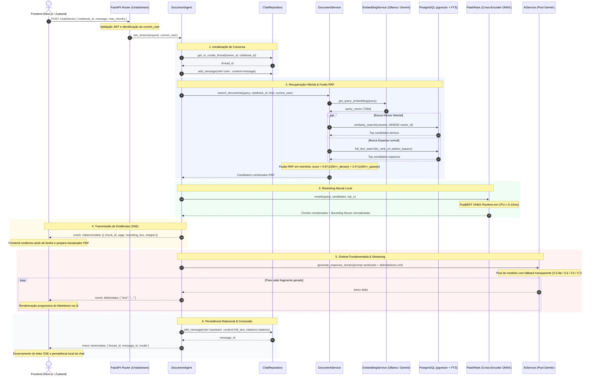
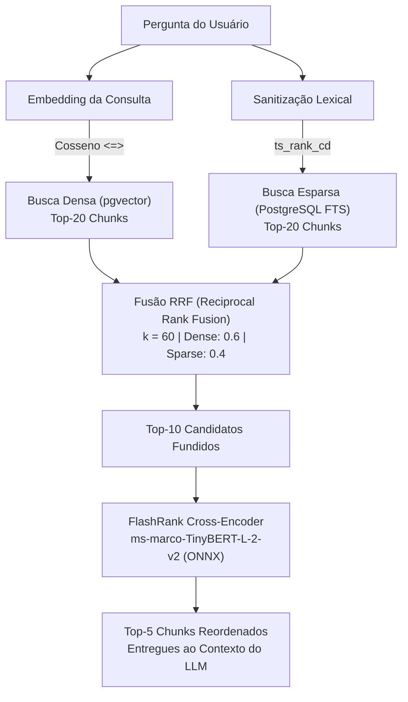

# Arquitetura do Sistema — Document AI Platform

Este documento detalha os componentes de arquitetura, fluxos de dados, sequência de eventos e decisões de design da plataforma **Document AI Platform**.

Para uma visão executiva e resumo do projeto, consulte o [README.md](../README.md).

---

## 1. Visão Geral da Arquitetura

A plataforma é construída sobre uma arquitetura em camadas no backend (FastAPI), desacoplada do cliente frontend (Next.js) e suportada por persistência relacional com extensões de inteligência artificial no PostgreSQL (`pgvector` e `pg_trgm`).

```
+---------------------------------------------------------------------------------+
|                                 FRONTEND                                        |
|   Next.js 16 (App Router) | React 19 | Tailwind CSS v4 | Zustand | Tiptap       |
+---------------------------------------+-----------------------------------------+
                                        | HTTP REST / Server-Sent Events (SSE)
+---------------------------------------v-----------------------------------------+
|                              FASTAPI BACKEND                                    |
|                                                                                 |
|  [ API Layer ]         /auth, /users, /documents, /notebooks, /chat, /evaluation |
|  [ Agent Layer ]       DocumentAgent (orquestração RAG e context building)      |
|  [ Service Layer ]     DocumentService, AIService, IngestionQueue, FlashRank    |
|  [ Repository Layer ]  UserRepository, DocumentRepository, ChatRepository       |
+--------------------+---------------------+--------------------+-----------------+
                     |                     |                    |
        +------------v------------+  +-----v------+  +----------v----------+
        |   PostgreSQL 16 + GIN   |  |   Ollama   |  |   Google Gemini     |
        |  pgvector (Cosseno/HNSW)|  | (Embeddings|  | (Síntese & Juízes   |
        |  PostgreSQL FTS (RRF)   |  |    Local)  |  |    LLM no Cloud)    |
        +-------------------------+  +------------+  +---------------------+
```

---

## 2. Diagrama de Sequência Detalhado (Ciclo RAG e Streaming SSE)

O diagrama abaixo descreve a sequência temporal completa de uma consulta de chat fundamentada em documentos, cobrindo autenticação, busca híbrida, reranking neural, geração progressiva de tokens e persistência de histórico:



---

## 3. Ciclo de Eventos SSE (Server-Sent Events)

O endpoint `POST /chat/stream` utiliza a especificação Server-Sent Events com codificação UTF-8. O ciclo de vida emite os seguintes eventos atômicos:

| Evento | Payload | Finalidade |
| :--- | :--- | :--- |
| `citations` | Lista JSON de objetos `DocumentCitation` (`document_title`, `page_number`, `bounding_box`, `similarity_score`, `text_snippet`) | Permite que o frontend construa imediatamente os seletores de evidência antes do primeiro token de texto ser gerado. |
| `delta` | Objeto JSON `{ "text": "token" }` | Emite progressivamente os fragmentos textuais produzidos pelo LLM para renderização em tempo real. |
| `done` | Objeto JSON `{ "thread_id": "...", "message_id": "...", "model": "..." }` | Notifica a conclusão bem-sucedida, fornecendo identificadores do banco para sincronização da interface. |
| `error` | Objeto JSON `{ "error": "descrição do erro" }` | Notifica interrupção na conexão com a API do LLM ou falha de processamento para tratamento na interface. |

---

## 4. Pipeline Assíncrono de Ingestão (`IngestionQueue`)

Para processamento de PDFs sem bloquear requisições HTTP, a plataforma adota uma fila interna desacoplada em memória:

```mermaid
flowchart LR
    Upload[Upload PDF<br/>POST /documents/upload] --> CreateDoc[Grava Documento<br/>status: PENDING]
    CreateDoc --> Queue[asyncio.Queue<br/>IngestionQueue]
    Queue --> Sem[asyncio.Semaphore<br/>Concorrência: 2]
    
    subgraph Pipeline["Worker de Ingestão"]
        Sem --> Parse[PyMuPDF / fitz<br/>Extração e Bounding Boxes]
        Parse --> Chunk[ChunkingService<br/>1000 tokens / 200 overlap]
        Chunk --> Embed[EmbeddingService<br/>Ollama nomic-embed-text]
        Embed --> SaveDB[PostgreSQL<br/>document_chunks + vetores]
    end

    SaveDB --> Done[status: COMPLETED]
    Pipeline -.->|Eventos SSE de progresso| SSEOut[GET /documents/{id}/progress]
```

### Características e Limitações da Ingestão Local:
- **Zero Infraestrutura Adicional**: Não requer corretores externos (Redis, Celery ou RabbitMQ) para execução local de pequeno e médio porte.
- **Controle de Carga**: O semáforo limita a 2 documentos simultâneos para evitar sobrecarga de CPU e memória durante a extração e cálculo de embeddings.
- **Transmissão de Progresso**: Clientes podem assinar o endpoint `GET /documents/{id}/progress` para receber atualizações percentuais e da fase de processamento via SSE.
- **Resiliência em Reinício**: Por ser mantida em memória via `asyncio.Queue`, tarefas em fila que ainda não iniciaram sua persistência são perdidas se o servidor backend for reiniciado.

---

## 5. Estratégia de Busca Híbrida e Reranking



1. **Braço Denso**: Recupera trechos com base no significado semântico utilizando a distância cosseno (`<=>`) sobre os vetores gerados pelo `nomic-embed-text` (dimensão 768).
2. **Braço Esparso**: Identifica correspondências léxicas exatas utilizando índices GIN e a função `ts_rank_cd` sobre dicionário `simple` para independência linguística no banco.
3. **Fusão RRF**: Aplica a fórmula canônica:
   $$RRF = \sum_{m \in \{dense, sparse\}} w_m \cdot \frac{1}{60 + \text{rank}_m}$$
   onde $w_{dense} = 0.6$ e $w_{sparse} = 0.4$.
4. **Reranking Neural com FlashRank**: Executa inferência via ONNX Runtime em CPU utilizando o modelo destilado `ms-marco-TinyBERT-L-2-v2` (~15 MB). Caso o modelo não esteja acessível, o sistema opera em fallback transparente, devolvendo a ordenação original do RRF.

---

## 6. Isolamento Multi-tenant e Segurança

A segregação entre usuários é aplicada de forma determinística na camada de acesso a dados:

- **Chave de Propriedade (`owner_id`)**: Todas as entidades de negócio (`Document`, `Notebook`, `ChatThread`) contêm o identificador do usuário proprietário.
- **Consultas Filtradas**: As buscas vetoriais e lexicais incluem obrigatoriamente a cláusula `WHERE documents.owner_id = :current_user_id`, impedindo que documentos de outro usuário sejam indexados ou recuperados em qualquer etapa do RAG.
- **Sanitização de Prompts**: Delimitadores de controle do tipo `[INST]`, `<<SYS>>` e similares são expurgados do texto dos chunks antes da injeção no prompt final, e as evidências são envelopadas em tags estruturadas `<document_evidence>`.
- **Prevenção de Path Traversal**: Arquivos PDF físicos gravados em disco recebem identificadores UUID aleatórios, desacoplados dos nomes de arquivo enviados pelo cliente.