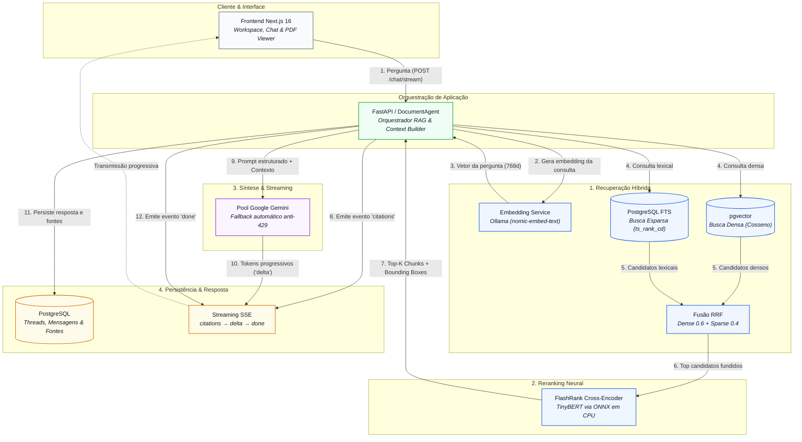

# 📄 Document AI Platform

> Plataforma inteligente de análise documental com recuperação híbrida, reranking neural e respostas fundamentadas com destaque visual em PDF.

[](https://www.python.org/)
[](https://fastapi.tiangolo.com/)
[](https://nextjs.org/)
[](https://github.com/pgvector/pgvector)
[](https://docs.pytest.org/)

---

## 📌 Visão Geral

A **Document AI Platform** é uma plataforma de análise documental inteligente que transforma PDFs em fontes pesquisáveis, permite fazer perguntas com respostas fundamentadas em evidências e destaca visualmente os trechos citados nos documentos originais.

Projetada para eliminar o risco de alucinações e a perda de rastreabilidade analítica na consulta a extensos acervos contratuais e regulatórios, a plataforma associa cada afirmação gerada diretamente à sua página e coordenada física (*bounding box*) no documento de origem.

Construída com **Python**, **FastAPI**, **Next.js** e **PostgreSQL**, combina busca híbrida vetorial e lexical, reranking neural, streaming de respostas em tempo real e um subsistema quantitativo de avaliação de RAG.

---

## ✨ Principais Recursos

1. **Pesquisa com Evidências e Destaque em PDF**
   Respostas associadas diretamente a fragmentos dos documentos, com navegação por páginas e destaque visual animado (*bounding box*) no visualizador de PDF integrado.

2. **Recuperação Híbrida (Dense + Sparse via RRF)**
   Combinação de busca vetorial por similaridade de cosseno (**pgvector**) com busca lexical por palavras-chave (**PostgreSQL Full-Text Search**), unificadas via algoritmo *Reciprocal Rank Fusion* (pesos 0.6 denso / 0.4 esparso).

3. **Reranking Neural em CPU (FlashRank)**
   Reordenação de alta precisão com o modelo Cross-Encoder `ms-marco-TinyBERT-L-2-v2` executado localmente via ONNX Runtime, otimizando o contexto entregue ao LLM sem exigir aceleração por GPU.

4. **Experiência em Tempo Real com Streaming SSE**
   Transmissão progressiva de tokens via *Server-Sent Events* (`POST /chat/stream`), com emissão antecipada de citações (`citations`), acompanhamento da fila de ingestão assíncrona (`IngestionQueue`) e editor de notas Tiptap integrado.

5. **Subsistema de Avaliação RAG e Métricas**
   Bateria de testes para mensurar quantitativamente a qualidade de recuperação e geração (**Recall@5**, **MRR@5**, **Faithfulness**, **Answer Relevancy**), incluindo testes de abstenção contra perguntas fora de escopo.

6. **Segurança Multicamadas e Isolamento Multi-tenant**
   Segregação mandatória de dados por usuário em todas as consultas SQL (`WHERE owner_id = :user_id`), sanitização de delimitadores de prompt contra injeção indireta e armazenamento de arquivos com identificadores UUID aleatórios.

---

## 🏛️ Arquitetura do Sistema

O diagrama abaixo apresenta a visão estruturada do pipeline de consulta e geração fundamentada:



> 📖 **Documentação Aprofundada**: Para o diagrama de sequência temporal completo, especificação de mensagens e ciclo de vida detalhado dos eventos SSE, consulte [docs/ARCHITECTURE.md](docs/ARCHITECTURE.md).

---

## 🚀 Stack Tecnológica

| Camada | Tecnologias Principais |
| :--- | :--- |
| **Backend** | Python 3.13, FastAPI 0.140, Uvicorn, SQLAlchemy 2.0, Pydantic v2 |
| **Banco de Dados & Busca** | PostgreSQL 16, pgvector (HNSW / Cosseno), PostgreSQL Full-Text Search (GIN), FlashRank 0.2.10 (Cross-Encoder ONNX) |
| **IA & Processamento** | Google GenAI SDK (Gemini 3.7/3.5/3.6 Flash), Ollama (`nomic-embed-text`), PyMuPDF 1.28 (`fitz`), pypdfium2 |
| **Frontend** | Next.js 16.4.1 (App Router), React 19.2, TypeScript 5, Tailwind CSS v4 |
| **Interface & Estado** | Tiptap 3.30 (Editor WYSIWYG), TanStack React Query v5, Zustand 5, Lucide React, Sonner |
| **Infraestrutura & Testes** | Docker, Docker Compose, Pytest 9.1, Pytest-asyncio, JSDOM |

---

## 📊 Avaliação RAG — Baseline Exploratório (v1.2)

A plataforma conta com um subsistema nativo de testes de avaliação offline baseado no paradigma *LLM-as-a-Judge*, com persistência estruturada de execuções em JSON (`backend/app/evaluation/runs/run-20260826-013344-00ce66.json`).

### Parâmetros & Limitações Metodológicas

Antes de analisar as métricas, é fundamental considerar as seguintes características metodológicas desta execução:

* **Tamanho Amostral Restrito ($N=6$)**: A bateria utiliza o dataset canônico `contracts_eval_v1.json`, composto por 5 perguntas factuais sobre cláusulas contratuais e 1 caso de teste negativo (pergunta fora de escopo para avaliar abstenção). Esta amostra serve como baseline de validação funcional do pipeline, e não como comprovação estatística ampla de desempenho generalista.
* **Viés de Autoavaliação (*Self-Judging Bias*)**: O mesmo modelo da família Gemini (`gemini-3.5-flash-lite`) atuou como gerador da resposta e como juiz avaliador das métricas de fidelidade (*Faithfulness*) e relevância (*Answer Relevancy*).
* **Tratamento de Abstenção**: Para a consulta fora de escopo (sem evidências nos documentos indexados), o sistema absteve-se de responder conforme instruído, obtendo pontuação máxima de fidelidade por não produzir alucinações.
* **Variabilidade de Latência e Limites de Cota**: Sob tiers gratuitos ou em baterias com maior volume de requisições, a latência de rede e a taxa de sucesso podem oscilar devido a limites de taxa (*HTTP 429 RESOURCE_EXHAUSTED*).

### Resultados da Execução

| Métrica | Baseline v1.2 (Gravado) | Quality Gate Exigido | Status |
| :--- | :---: | :---: | :---: |
| **Recall@5** | 100,0% (1.00) | $\ge$ 90,0% | ✅ Aprovado |
| **MRR@5** | 1,000 | $\ge$ 0,850 | ✅ Aprovado |
| **Faithfulness (Fidelidade)** | 100,0% (1.00) | $\ge$ 90,0% | ✅ Aprovado |
| **Answer Relevancy (Relevância)** | 100,0% (1.00) | $\ge$ 95,0% | ✅ Aprovado |
| **Success Rate (Taxa de Sucesso)** | 100,0% (1.00) | $\ge$ 95,0% | ✅ Aprovado |
| **P50 Latency** | 784 ms (~0,78 s) | $<$ 3.000 ms | ✅ Aprovado |
| **P95 Latency** | 4.123 ms (~4,12 s) | $<$ 8.000 ms | ✅ Aprovado |
| **P99 Latency** | 5.001 ms (~5,00 s) | — | Referência |
| **Latência Média** | 1.499 ms (~1,50 s) | — | Referência |

*Nota sobre a latência*: O P95 registrado é de **4.123 ms (4,12 segundos)**, influenciado pelo tempo de geração do caso negativo de abstenção (5.220 ms), situando-se confortavelmente dentro do teto estipulado pelo quality gate de 8.000 ms.

---

## ⚙️ Instalação e Execução

### 1. Configurar Variáveis de Ambiente

Copie o arquivo de exemplo para `.env` na raiz do projeto:

```bash
cp .env.example .env
```

> ⚠️ **Configuração de Portas**: Por padrão, o PostgreSQL com pgvector é exposto na porta do host **`5434`** (mapeada para `5432` no container) para evitar conflitos com eventuais instâncias locais já em execução. Certifique-se de manter `POSTGRES_PORT=5434` no `.env`.

Para execução dos testes automatizados locais, gere o `.env.test`:
```bash
cp .env.test.example .env.test
```

Defina sua chave de API e selecione os modelos no arquivo `.env`:
```env
GOOGLE_API_KEY=sua_chave_do_google_ai_studio
GEMINI_MODEL=gemini-3.7-flash
EMBEDDING_PROVIDER=ollama
```

### 2. Iniciar Serviços via Docker Compose

Inicie o banco de dados com pgvector, o container do Ollama e a API FastAPI:

```bash
docker compose up -d --build
```

* **Swagger UI (Documentação Interativa)**: `http://localhost:8000/docs`
* **Redoc**: `http://localhost:8000/redoc`

*(Opcional)* Para executar o backend localmente no host fora do Docker:
```bash
python -m venv .venv
# Linux/macOS: source .venv/bin/activate
# Windows PowerShell: .\.venv\Scripts\Activate.ps1
pip install -r requirements.txt
```

### 3. Iniciar o Frontend

Em outro terminal, instale as dependências com o lockfile estrito e inicie o servidor Next.js:

```bash
cd frontend
npm ci
npm run dev
```

* **Workspace da Plataforma**: `http://localhost:3001` (porta padrão definida no script de desenvolvimento)
* **Dashboard de Avaliação & Métricas**: `http://localhost:3001/evaluation`

---

## 🧪 Testes e Benchmarks

### Backend (Pytest)

A plataforma conta com **71 testes automatizados** no backend, cobrindo validações de sanitização, parsing, chunking, busca híbrida, autenticação JWT e integridade multi-tenant:

```bash
# 1. Executar testes de unidade isolados (sem necessidade de banco de dados ativo)
pytest backend/app/tests/test_evaluation_metrics.py backend/app/tests/test_sanitization.py backend/app/tests/test_parsing_service.py

# 2. Executar suíte completa (requer PostgreSQL na porta 5434 ativo via Docker)
pytest backend/app/tests/

# 3. Executar o benchmark oficial de avaliação RAG via CLI (Baseline v1.2)
python -m app.evaluation.runner --dataset backend/app/evaluation/datasets/contracts_eval_v1.json --name "Baseline v1.2" --baseline --top_k 5
```

### Frontend (Node.js & Turbopack)

```bash
cd frontend

# Executar testes automatizados de segurança e sanitização do Tiptap
npm test

# Executar validação de tipos e build de produção Next.js
npm run build
```

---

## 🔒 Segurança e Confiabilidade

* **Isolamento de Dados Multi-tenant**: Todas as operações de leitura e persistência em nível de repositório (`UserRepository`, `DocumentRepository`, `ChatRepository`) utilizam a cláusula mandatória `WHERE owner_id = :user_id`, garantindo segregação total entre usuários.
* **Proteção contra Injeção Indireta de Prompt**: Caracteres de controle invisíveis são expurgados, delimitadores de instrução (`[INST]`, `<<SYS>>`) são desativados e os trechos de documentos são encapsulados em tags `<document_evidence>`.
* **Criptografia e Armazenamento Seguro**: Senhas protegidas com hashing **Argon2id** (via `pwdlib`). Documentos enviados recebem nomes com identificadores UUID aleatórios para mitigar riscos de *Path Traversal*.
* **Fila de Ingestão Desacoplada (`IngestionQueue`)**: O processamento de PDFs é executado em segundo plano via `asyncio.Queue` com semáforo de concorrência limitado a 2 documentos simultâneos, transmitindo o progresso em tempo real via SSE. Por operar em memória para simplificar a infraestrutura local, tarefas pendentes na fila não são preservadas caso o servidor seja reiniciado antes da conclusão.
* **Pool Resiliente de Modelos**: Diante de respostas de cota (*HTTP 429*) ou instabilidades temporárias do provedor (*HTTP 503*), o serviço aplica alternância automática entre modelos Gemini (`gemini-3.5-flash-lite`, `gemini-3.6-flash`, `gemini-3.5-flash`, `gemini-3.7-flash`), reduzindo o impacto de limitações de cota sobre a experiência do usuário.

---

## 📂 Estrutura do Projeto

```bash
document-ai-platform/
├── backend/app/
│   ├── agents/           # Orquestrador RAG (DocumentAgent) e context builder
│   ├── api/              # Rotas REST (/auth, /notebooks, /documents, /chat, /evaluation)
│   ├── core/             # Configurações Pydantic, segurança JWT/Argon2id e IngestionQueue
│   ├── database/         # Modelos SQLAlchemy, conexão e migrações automáticas
│   ├── evaluation/       # Runner de benchmark, juízes LLM, métricas e datasets canônicos
│   ├── repositories/     # Acesso a dados, busca híbrida RRF e isolamento multi-tenant
│   ├── schemas/          # Modelos Pydantic de entrada e saída tipados
│   ├── services/         # Serviços (IA, Embeddings, Ingestão, Parsing PyMuPDF, FlashRank)
│   └── tests/            # Suíte completa de testes automatizados via Pytest
├── frontend/src/
│   ├── app/              # Rotas Next.js App Router (Auth, Workspace de Cadernos, Evaluation)
│   ├── features/         # Componentes do Workspace (Fontes, Chat SSE, Studio Tiptap, PDF Viewer)
│   ├── hooks/            # Custom hooks React (useDocumentProgress via SSE)
│   ├── stores/           # Gerenciamento de estado Zustand (Chat, Notebook, Auth)
│   └── types/            # Tipos e contratos TypeScript da API
├── docs/                 # Documentação detalhada de arquitetura e fluxos
├── docker-compose.yml    # Orquestração de containers (FastAPI, PostgreSQL pgvector, Ollama)
├── Dockerfile            # Imagem do backend (Python 3.13-slim)
└── requirements.txt      # Dependências do backend pinadas
```